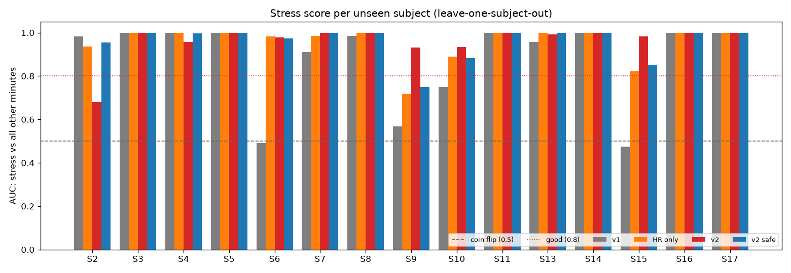

# Grounded

Grounded is a breathing and heart-rate-variability coach that I am building as a learning project.
It has three parts:

- **A chest pod** that measures my ECG and my breathing with one chip, the TI ADS1292R.
- **A desk light** that slowly gets brighter and darker to guide my breathing.
- **A small app on my computer** that stores everything in SQLite, calculates a stress score,
  starts a breathing session on the desk light when I need it, and writes me a short note every
  evening with a local LLM.

I wanted a project that brings together the things I already know: STM32, Arduino, PCB design,
Python, SQL, machine learning and LLMs. I also wanted it to be useful in daily life, not just a demo.



## How I work on it

- **Simulation first.** I had no hardware and no budget at the start, so I built and tested
  everything in simulation: the firmware in Wokwi, the signals with the public WESAD dataset.
- **Python first, then C++.** Every algorithm is written in Python first, where it is easy to
  test, and then ported to C++ for the microcontroller.
- **The same code everywhere.** The firmware logic is plain C++ with no Arduino calls, so the
  exact same code runs on the STM32, on my Mac and in the simulators. Only a thin layer for pins
  and SPI is board-specific.
- **Bit-identical results.** Python, C++ on the Mac and C++ on the STM32 produce the same events.
  I compile with `-ffp-contract=off` so no platform fuses multiply and add differently.
- **Measure, don't guess.** When I optimize, I measure first. Wokwi runs the STM32 about 10 times
  slower than real hardware, so I calibrate its timing instead of trusting raw numbers.

## Decisions

### Sensor and hardware
- **ADS1292R** for ECG and respiration. One chip measures both: respiration by impedance
  pneumography through the same electrodes.
- **The product will be a garment** with textile electrodes. The pod snaps on and comes off for
  washing. The production microcontroller will be an **STM32WB** for Bluetooth.
- **Battery only, for safety.** The pod is never connected to mains power while it touches the
  body, and it will not charge while it is worn. While prototyping, my laptop runs on battery
  with nothing else plugged in (no charger, no external monitor, no Ethernet).
- **Electrode contact (lead-off) is detected** and reported, so bad data is not trusted.
- **Prototype parts:** a CUNZJIA ADS1292R module, a NUCLEO-L476RG (Cortex-M4F with FPU, close to
  the STM32WB), 3M Red Dot 2238 electrodes, and an LED inside a ping-pong ball as the desk light.

### Signals
- **ECG at 250 Hz, respiration at 25 Hz.** The chip samples both at 250 Hz and the firmware
  averages respiration down to 25 Hz.
- **Breath detector:** band-pass 0.05–1 Hz, then zero crossings with an adaptive threshold and
  hysteresis. A breath hold is "no breath for 2× my usual breath interval, at least 10 s". A fixed
  10 s limit called slow breathing a breath hold, even the 6 breaths/min rhythm my own coach
  recommends.
- **Heartbeat detector:** a simplified Pan-Tompkins with a search back in the raw ECG to find the
  exact R peak.
- **HRV:** RMSSD and heart rate over 60-second windows.

### Firmware
- **The pod sends events, not raw data:** breaths, breath holds, HRV windows and electrode contact,
  as short text lines with integers only. Sending raw data over Bluetooth would drain the battery.
- **An interrupt reads the ADS1292R** on every new sample and puts it in a lock-free FIFO. The
  main loop processes the FIFO, so a slow moment never loses a sample.
- **The driver follows the datasheet strictly**, and I test it on my Mac against a simulated
  chip that reports every rule I break. I also wrote a Wokwi custom chip with sliders for heart
  rate, breathing rate, HRV, breath hold and electrode contact.
- **A bring-up firmware for the first day with real hardware:** it checks SPI and the chip ID,
  dumps the registers, measures the chip's internal test signal (so I can test the board without
  touching my body), and then streams raw data to a live plot.
- **No division and no `%` in the hot path on the Cortex-M0+**, which has no hardware divide.

### Stress score
- **Relative to my own normal**, never absolute thresholds. 50 means "like my normal".
- **Weights are learned from data**, evaluated leave-one-subject-out on 15 WESAD subjects: the
  model is always tested on a person it never saw. It works well for 14 of 15 unseen people.
- **HRV is not in the score.** Fitted freely, the model learned that *high* HRV means stress,
  because the WESAD stress task is a spoken talk and talking raises RMSSD. That is a shortcut that
  would fail for silent, everyday stress, so I only allow HRV in the physiological direction,
  and the data then gives it no weight. The score uses heart rate and breathing irregularity.
- **Known limit:** excitement (like laughing) also raises heart rate. The score measures tension,
  not its reason.

### Coach and desk light
- **When to guide:** stress ≥ 70 for 3 minutes in a row. It then starts the **Relax 4-0-6-0**
  rhythm (6 breaths per minute with a long exhale) for one minute.
- **It should not nag:** at least 20 minutes between sessions, it never interrupts a session I
  started myself with the button, and it waits until it has 30 minutes of my data.
- **Every session is stored** with my stress before and after, so I can later see if it helps me.
- **The light** glows faintly when idle. The host controls it with a simple text protocol, and its
  button starts a session or switches to the next rhythm.

### LLM features
- **Local only, with Ollama.** My health data never leaves my computer.
- **Python calculates the facts, the LLM only writes.** The evening note is built from numbers
  that Python computed, and every number in the reply is checked against those facts.
- **Text-to-SQL with guards:** I can ask questions about my data in plain English. The query runs
  on a read-only connection, with an authorizer that only allows reading my tables, a 2-second
  timeout and a 50-row limit.
- **Everything is in English.**

## Results so far (simulation and WESAD)

| What | Result |
|---|---|
| Python vs C++ vs STM32 | identical events |
| Beat detection on 15 subjects | 99–100% sensitivity |
| Full pod chain (simulated chip, driver, FIFO, pipeline) vs reference | 100% of events match on 15 subjects |
| Beat detector on STM32 at 48 MHz (estimated) | ~98 µs average per sample, 2.5% of the budget |
| Stress score, unseen subjects with AUC ≥ 0.8 | 14 / 15 (hand-made v1: 11 / 15) |
| Coach replay on 7 days | 7 sessions, all during or just before the stress task, none during calm parts |
| Text-to-SQL test set (llama3.2) | 11 / 12 |

## Layout

```
firmware/
  lib/grounded_dsp/     breath and beat detectors, HRV, pod pipeline, protocol
  lib/ads1292r/         ADS1292R driver and the sample FIFO
  lib/grounded_led/     breathing pacer and desk light behaviour
  grounded_pod/         pod firmware, bring-up firmware, Wokwi custom chip
  breath_led/           desk light firmware
  dsp_target_test/      on-target timing and bit-exact test
  test_native/          everything above, built and tested on the Mac
host/                   the app: database, metrics, coach, live loop, LLM, scope
research/               data preparation, reference algorithms, evaluations
```

## Running it

```bash
python -m venv .venv && source .venv/bin/activate && pip install -r requirements.txt
```

WESAD is not included (its license does not allow sharing). Download it, then:

```bash
python research/prepare_data.py S2 ~/Downloads/WESAD
make -C firmware/test_native test
python host/ingest.py --subject S2 --start "2026-11-12 09:00"
python host/metrics.py
python host/live.py --pod sim:S2 --led sim --speed 60
python host/reflect.py --date 2026-11-12
python host/ask.py "Which day this week was the most stressful?"
python research/stress_v2.py
```

The LLM features need [Ollama](https://ollama.com) with `llama3.2`.

## First day with hardware

1. Laptop on battery. Connect only 5V and GND to the ADS1292R module, and measure the 3.3V test
   point and the idle level of DRDY. It should be 3.3 V before I wire the data lines.
2. Wire it (pin table in `firmware/grounded_pod/platformio.ini`) and upload the bring-up firmware:
   `pio run -e bringup_l476rg -t upload`. Steps 1–3 must pass with no electrodes attached.
3. Attach the electrodes and look at the signals: `python host/scope.py --port <port>`.
4. Upload the pod firmware (`pio run -e l476rg -t upload`) and run `python host/live.py --pod serial:<port>`.

## What's next

- Test everything on real hardware and tune the respiration phase, gains and electrode layout.
- Motion sensor (IMU) and talking detection, so the score knows when the data can't be trusted.
- STM32WB with Bluetooth, a battery, and the garment.
